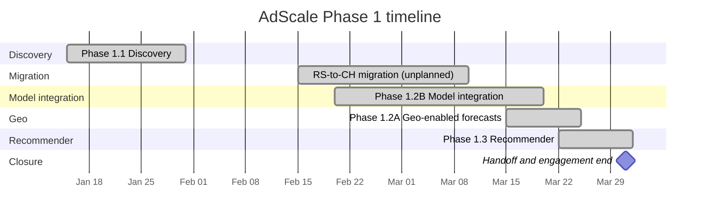

# Case study: AdScale Phase 1 (anonymized)

> **Anonymization disclosure.** This is a real engagement, fully fictionalized. Company names, people, product names, and a few internal acronyms have been replaced. Technical specifics (programmatic ad tech, win rate predictions, ZIP-level forecasting, ClickHouse, model integration) and the operational shape of the engagement (timeline, scope, escalations, retrospective) are real. The framework artifacts are exactly as they were used.
>
> See the bottom of this README for the persona/entity legend.

## The engagement at a glance

| | |
|---|---|
| **Client** | AdScale - a privacy-first programmatic ad exchange |
| **Vendor** | Northwind Consulting - boutique data engineering shop |
| **PM allocation** | 0.5 FTE, fractional |
| **Vendor team** | 1 engineering lead + 2 engineers + 1 PM (this narrator) |
| **Engagement window** | Jan 15 - Mar 31, 2026 (~11 weeks) |
| **Scope** | Phase 1 of a planned multi-phase engagement: forecasting + recommendation API for AdScale's Media Planning Tool |
| **Outcome** | All three deliverables shipped to production on schedule. Phase 2 frozen due to client-side champion transition. |

## Why this case study exists

The framework in this repo (`build/`) is theoretical until you can see what it produces. This case study is a complete worked example: every artifact you'd expect from a fractional PM running a real engagement, captured in the structure the framework prescribes.

If you're evaluating whether the framework is worth adopting, this is what the output looks like at week 11.

## Phase timeline

## Navigation map

If you want to see... | Look at...
---|---
**Engagement framing** - what the project is, why it exists | [`BRIEF.md`](BRIEF.md)
**Final state** - what shipped, what's open, what's frozen | [`STATUS.md`](STATUS.md)
**Operating mode** - rhythm, capture habits, anti-patterns | [`WAYS-OF-WORKING.md`](WAYS-OF-WORKING.md)
**Per-project agent persona** - how Claude was tuned for this engagement | [`CLAUDE.md`](CLAUDE.md)
**Definition of Done with rigor** | [`decisions/2026-02-19-phase-1-dod.md`](decisions/2026-02-19-phase-1-dod.md)
**Handling a hard scope-change request mid-flight** | [`decisions/2026-03-12-product-qa-gate-scope-change.md`](decisions/2026-03-12-product-qa-gate-scope-change.md)
**Technical decision tracking** | [`decisions/2026-03-17-versioned-pair-deploy-plan.md`](decisions/2026-03-17-versioned-pair-deploy-plan.md)
**Process decision with stakeholders** | [`decisions/2026-02-24-confluence-approval-process.md`](decisions/2026-02-24-confluence-approval-process.md)
**A full Amazon-style WBR** | [`comms/2026-03-06-wbr-w10.md`](comms/2026-03-06-wbr-w10.md)
**One-page status under pressure** | [`comms/2026-03-12-phase1-status-onepager.md`](comms/2026-03-12-phase1-status-onepager.md)
**Escalation email - draft and final** | [`comms/2026-03-16-escalation-email-draft.md`](comms/2026-03-16-escalation-email-draft.md), [`comms/2026-03-16-escalation-email-option-A-close.md`](comms/2026-03-16-escalation-email-option-A-close.md)
**Specs (data pipeline + feature)** | [`docs/specs/forecast-data-pipeline.md`](docs/specs/forecast-data-pipeline.md), [`docs/specs/spec-audience-broadening.md`](docs/specs/spec-audience-broadening.md)
**Daily notes** - five days from across the engagement | [`docs/daily/`](docs/daily/)
**Retrospective** - what worked, what didn't, would I do it again | [`retro/framework-retro.md`](retro/framework-retro.md)

## What worked, what didn't

This is a method retrospective, not a project retrospective. For the project version, see the project STATUS.md.

**What the framework did well:**

- Cross-session context retention. Walking back into the project after a weekend or a holiday took minutes, not an hour. STATUS.md and the daily notes worked as intended.
- Spec accuracy. Specs grounded against the actual code (read-only clone in `projects/X/code/`) caught discrepancies between what was discussed and what was built.
- Status-update-from-context. WBRs and weekly statuses got drafted in 5-10 minutes from the existing artifacts, not 45-60 minutes from scratch.
- Decision documentation. Every meaningful call got a decision doc with options, rationale, and consequences. Future-me could reconstruct the why without asking the team.

**Where the framework was thin:**

- No good built-in workflow for processing call transcripts at speed - the `process-document` skill helped but was generic. A dedicated transcript-to-decisions skill would have saved hours.
- Per-project agent persona (the `PROJECT-CLAUDE.md` pattern) was added late in the engagement; earlier projects relied on workspace defaults and the outputs were noticeably less calibrated.
- Cross-project visibility (when a question in this engagement related to a similar question in another) was manual. The "workspace context" promise has room to grow.

**What broke:**

- Mid-March, an unscoped client-side QA gate was introduced (see `decisions/2026-03-12-product-qa-gate-scope-change.md`). The framework helped track and escalate the change, but did not prevent the underlying scope creep.
- Internal weekly status reports diverged from project reality at one point. The framework caught it but only because daily notes were comprehensive enough to cross-reference. A weaker capture habit would have masked it.

For a longer treatment, read [`retro/framework-retro.md`](retro/framework-retro.md).

## Persona / entity legend

This case study uses these stand-ins. The full anonymization key is intentionally not committed to the repo.

**Companies & products**

| Stand-in | What it represents |
|---|---|
| AdScale | The client - a privacy-first programmatic ad exchange |
| Northwind Consulting | The vendor - the consulting shop the PM works for |
| Forecast Service | The API being built |

**People (Northwind side)**

| Stand-in | Role |
|---|---|
| PM | The narrator. 0.5 FTE engagement lead. |
| ENG-LEAD | Senior backend engineer, technical lead on the project |
| ENG-1, ENG-2 | Engineers (data engineer, data scientist) |
| DELIVERY-LEAD | Director of Solution Engineering at Northwind. Account oversight. |
| CONSULTING-CEO | Northwind CEO. Mostly off-screen. |

**People (AdScale side)**

| Stand-in | Role |
|---|---|
| CLIENT-PRODUCT | Director of Product. Primary product owner and decision maker. |
| CLIENT-VP-DS | VP of Data Science. Senior decision maker. |
| CLIENT-DS-LEAD | Data science lead. Main technical counterpart. |
| CLIENT-PRODUCT-MGR | PM on the data science side. PR reviews and code merges. |
| CLIENT-FRONTEND-LEAD | Lead of the frontend team that consumes the API |
| CLIENT-DATA-PLATFORM | Data platform team |
| CLIENT-DEVOPS-1, CLIENT-DEVOPS-2 | DevOps / infra |
| CLIENT-DECISION-1, CLIENT-DECISION-2 | Senior decision makers above the day-to-day team |
| CLIENT-PRODUCT-BIZ | Business-side product role (referenced in passing) |
| CLIENT-PERSONA-LEAD | Lead of the audience modeling team |

**Environments & infrastructure**

| Stand-in | What it represents |
|---|---|
| STAGING | The single-instance pre-prod environment with limited resources |
| (third-party DSP), (internal DSP) | Real DSP names redacted |

**GitHub handles**

Real GitHub usernames have been replaced with descriptive stand-ins (`pm-gh`, `eng-lead-gh`, `client-ds-lead-gh`, etc.). PR numbers are kept as-is - they're meaningful for showing the rhythm of delivery without leaking anything.
