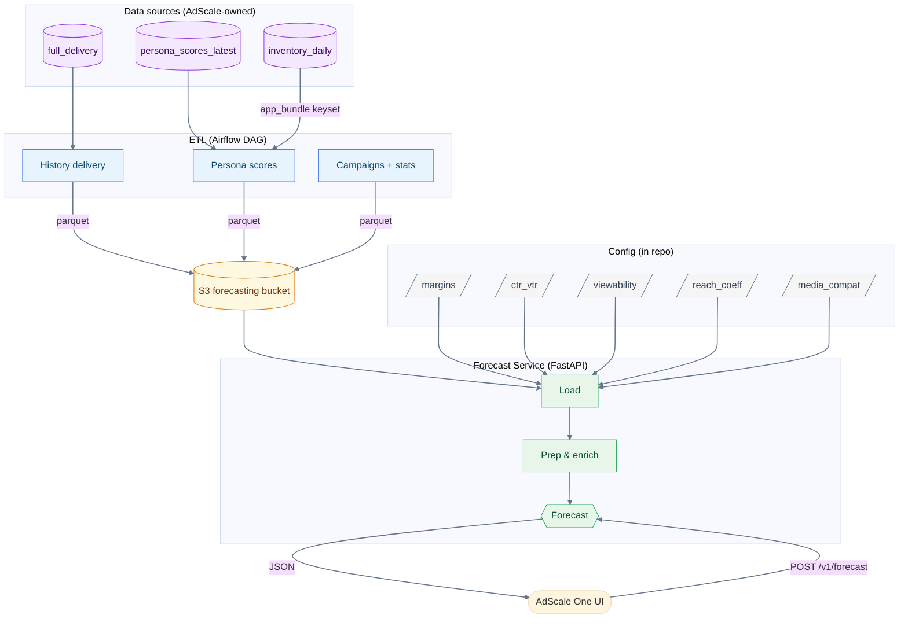
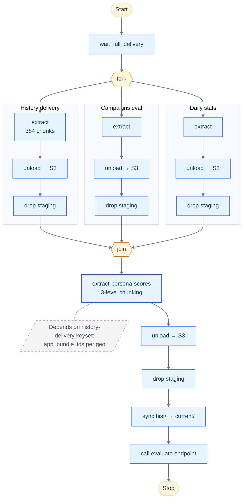

# Forecast Service - data pipeline

> Technical reference for PM. How data flows from raw ClickHouse tables through ETL to API response.

## System overview



**Legend** — full identifiers (truncated in diagram for width):

| Diagram label | Full path |
|---|---|
| `full_delivery` | ClickHouse `delivery_monitoring.full_delivery` |
| `persona_scores_latest` | ClickHouse `audience.persona_scores_latest` |
| `inventory_daily` | ClickHouse `ad_request.inventory_daily` |
| `S3 forecasting bucket` | `s3://adscale-forecasting-{env}-{region}/` |
| `margins` / `ctr_vtr` / `viewability` / `reach_coeff` / `media_compat` | `country_margins.csv` / `ctr_vtr_metrics.csv` / `viewability_metrics.csv` / `persona_reach_coeff.csv` / `media_type_compat.csv` |

## ETL pipeline (Airflow DAG)

Runs every 2 hours in prod. Extraction date = logical_date - 2 days.



**Per-task detail** (omitted from diagram for readability):

| Task | Source → target |
|---|---|
| `extract-history-delivery-data` | ClickHouse `full_delivery` → staging table; 384 chunks (24h × 16 hash buckets) |
| `extract-campaigns-eval-dataset` | Redshift → CH staging |
| `extract-campaigns-daily-stats` | Redshift → CH staging |
| `unload-*` | staging table → S3 parquet |
| `extract-persona-scores` | ClickHouse `persona_scores_latest` → staging; 3-level chunking (geo × persona batch × hash bucket) |
| `sync-hist-current-directories` | S3: `hist/` → `current/` |

### Chunking strategy (why it's complex)

ClickHouse can't handle full table scans on `full_delivery` (billions of rows). The ETL splits queries into deterministic chunks:

**History delivery** - 2 dimensions:
- Time windows: 60-min buckets across 24h
- App bundle hash: `cityHash64(app_bundle_id) % 16`
- Total: ~384 INSERT chunks per run

**Persona scores** - 3 dimensions:
- Per geography (distinct geoip_code from inventory)
- Per persona batch (256 persona_ids per batch)
- Per app bundle hash bucket (16 buckets)

Parameters must stay synchronized between build and extract scripts. Wrong PREWHERE boundary = silent data loss.

## Forecast Service request flow

What happens when AdScale One sends a `POST /v1/forecast`:

```mermaid
%%{init: {'theme':'base','flowchart':{'curve':'basis','nodeSpacing':35,'rankSpacing':50}}}%%
flowchart TD
 accTitle: Forecast Service request processing pipeline
 accDescr: Load stage pulls data from S3 and config CSVs; Prep stage joins, filters, and enriches; Compute stage derives metrics, cumulative sums, CPM guidance, and forecast; Response returns JSON.

 START([Start])

 subgraph Load["Load"]
 L1[Load win rates]
 L2[Load persona scores]
 L3[Load config CSVs]
 L4[Apply incl/excl lists]
 L1 --> L2 --> L3 --> L4
 end

 subgraph Prep["Prep"]
 P1[Compute total requests]
 P2[Join all sources]
 P3[Filter zero price]
 P4[Enrich with KPIs]
 P5{persona_id?}
 P6[Apply persona filter]
 P7[Rescale by flight duration]
 P8[Apply fill rate]
 P1 --> P2 --> P3 --> P4 --> P5
 P5 -->|yes| P6 --> P7
 P5 -->|no| P7
 P7 --> P8
 end

 subgraph Compute["Compute"]
 C1[Compute per-row metrics]
 C2[Sort + cumulative sums]
 C3{truncate?}
 C4[Truncate bottom 50%]
 C5[Generate CPM curve]
 C6[Forecast at budget]
 C7[Compute ventilation]
 C1 --> C2 --> C3
 C3 -->|yes| C4 --> C5
 C3 -->|no| C5
 C5 --> C6 --> C7
 end

 subgraph Response["Response"]
 R1[Return JSON]
 end

 STOP([Stop])

 START --> L1
 L4 --> P1
 P8 --> C1
 C7 --> R1
 R1 --> STOP

 classDef load fill:#e8f5e9,stroke:#16a34a,color:#064e3b;
 classDef prep fill:#e0f2fe,stroke:#0284c7,color:#075985;
 classDef compute fill:#fef3c7,stroke:#d97706,color:#78350f;
 classDef response fill:#ede9fe,stroke:#7c3aed,color:#4c1d95;
 classDef decision fill:#fff8e1,stroke:#d97706,color:#78350f;

 class L1,L2,L3,L4 load;
 class P1,P2,P3,P4,P6,P7,P8 prep;
 class C1,C2,C4,C5,C6,C7 compute;
 class R1 response;
 class P5,C3 decision;

 linkStyle default stroke:#64748b,stroke-width:1.5px
```



**Step reference** (details omitted from diagram for readability):

| Stage | Step | Detail |
|---|---|---|
| Load | Load win rates | from S3 parquet — filter by `geoip_code, env, ad_unit, device` |
| Load | Load persona scores | from S3 parquet — filter by `persona_id + geoip_code` |
| Load | Load config CSVs | margins, CTR/VTR, viewability, reach coefficients, media type compat |
| Load | Apply incl/excl lists | app bundle domain control |
| Prep | Compute total requests | `GROUP BY (date, geo, env, ad_unit, asset)` `SUM(nb_requests)` |
| Prep | Join all sources | win rates + persona scores + configs (3 LEFT JOINs) |
| Prep | Filter zero price | `WHERE responded_price > 0` |
| Prep | Enrich with KPIs | JOIN CTR/VTR + viewability by `(geo, env, ad_unit, device)` |
| Prep | Apply persona filter | `WHERE score > 0.6` (default) |
| Prep | Rescale by flight duration | `nb_requests *= days_in_range` |
| Prep | Apply fill rate | `nb_fillable = floor(nb_requests * fill_rate)` |
| Compute | Compute per-row metrics | impressions, budget, charged_price, reach, clicks, completions, viewable — see formulas below |
| Compute | Sort + cumulative sums | sort ascending by `responded_price`; cumulate impressions, budget, reach, clicks, completions |
| Compute | Truncate bottom 50% | remove low-price inventory bias |
| Compute | Generate CPM curve | loop `CPM = 0.5, 1.0, ..., 100.0`; interpolate impressions at each step |
| Compute | Forecast at budget | linear interpolation on cumulative curve — find `(impressions, CPM, reach)` at budget |
| Compute | Compute ventilation | split by `environment × ad_unit` |
| Response | Return JSON | `recommendedCpm`, `recommendedImpressions`, `estimatedReach`, `estimatedAvgCtr/Vtr/Viewability`, `cpmGuidance[]` (supply curve), `recommendedComposition` |

**Per-row metric formulas** (from "Compute per-row metrics"):

```
impressions = fillable_requests * win_rate
budget = impressions * charged_price
charged_price = responded_price / (1 - margin)
reach = impressions * (a * exp(-b * impressions) + c)
clicks = impressions * agg_ctr
completions = impressions * agg_vtr
viewable = impressions * agg_viewability
```

## Key data transformations

### Persona reach (exponential decay)

```
persona_ratio = a * exp(-b * impressions) + c
persona_reach = impressions * persona_ratio
```

Coefficients (a, b, c) looked up per (country, environment) with a **4-level fallback**:
1. Exact (country, environment) match
2. Country only (environment = "-1")
3. Environment only (country = "-1")
4. Global default ("-1", "-1")

### Win rate computation

- **v1** (current): `win_rate = nb_impressions / nb_requests` from historical delivery data
- **v2** (PR #121): `predicted_win_rate` from CLIENT-DS-LEAD's impression rate model CSV, keyed on (geo, env, ad_unit, device, responded_price)

Both feed the same downstream formula: `impressions = fillable_requests * win_rate`

### CPM with margins

```
charged_price = responded_price / (1 - country_margin)
```

Margin config: per-country CSV. FR = 50%, fallback = 40%. Video inventory: +3pp on top.

### Supply/demand intersection

The supply curve is cumulative impressions sorted by CPM ascending. The demand curve is `impressions = 1000 * budget / CPM`. The recommended CPM is where they intersect, found via linear interpolation on the cumulative curve.

## Data versioning (in progress)

ENG-LEAD is adding conditional data source routing behind the same `/v1/forecast` endpoint:

| Version | Data source | PR | Status |
|---------|------------|-----|--------|
| v1 | Historical win rates from delivery data | (current) | Prod |
| v2 | Predicted win rates from model CSV | #121 (service) + #125 (ETL) | In review |
| v3 | Predicted CTR/VTR/viewability from model CSVs | #122 (service) | In review |

Auto-detection router selects v1/v2/v3 based on presence of new data files on S3. Backward compatible - falls back to v1 if model data not present.

## S3 data layout

```
s3://adscale-forecasting-{env}-{region}/
 data/
 hist/
 dt={extraction_date}/
 bid_guidance_poc_raw_ct/ # win rates (history delivery)
 inventory_date={date}/*.parquet
 personae_assets_scores_snapshot/ # persona scores
 *.parquet
 current/ # synced from hist/ (latest)
 bid_guidance_poc_raw_ct/
 personae_assets_scores_snapshot/
 northwind/ # model prediction CSVs (from CLIENT-DS-LEAD)
 impression_rate.csv
 ctr.csv
 vcr.csv
 viewability.csv
```
